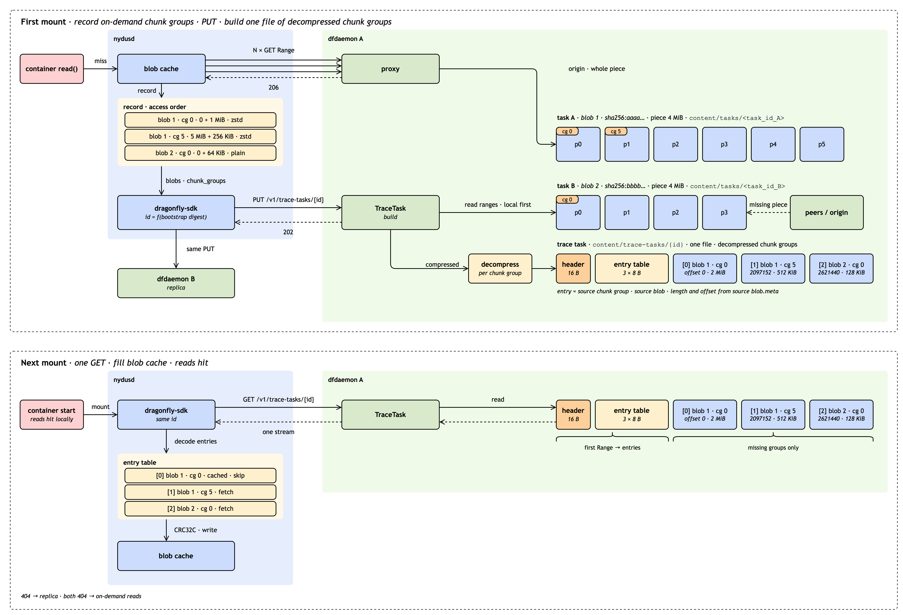
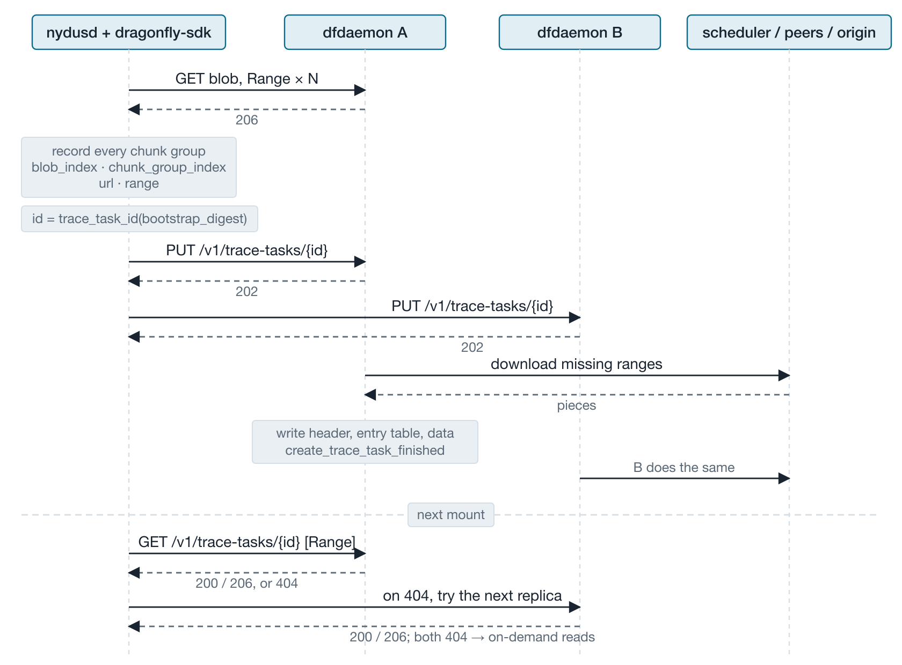
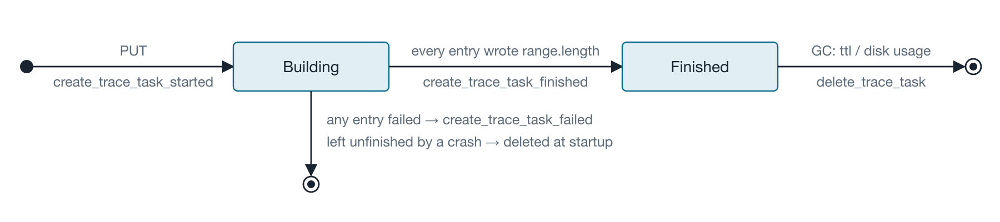
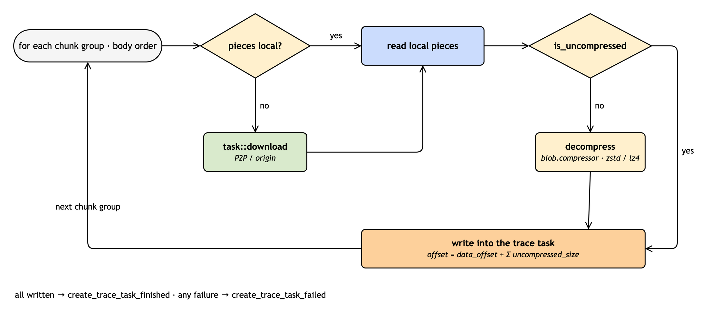

# Trace Task

## Overview

TraceTask is a new task type of the Dragonfly client for nydus. nydusd records the chunk groups it reads on
demand during one run and uploads the list to dfdaemon. dfdaemon copies those groups out of the source blobs,
byte for byte, into one nydus ondemand (redirect) blob, the artifact `nydus optimize` builds, and stores it as
one local file. On the next mount nydusd streams that file with `Range` through its redirect prefetch and fills
the source blobs' caches, so a cold start issues a few sequential reads instead of thousands of scattered ones.

## Goals

1. Add `TraceTask`, a local file task served over HTTP with `Range`, holding a nydus ondemand (redirect) blob
   built from the chunk groups a nydusd read.
2. Reuse the existing storage, garbage collection and proxy patterns; no change to `dragonfly-api` or the configuration.
3. Derive the task id on the client so uploads are idempotent and downloads need no lookup; replicate in `dragonfly-sdk`.

## Architecture



The trace task is a plain file next to the tasks it was built from and is never announced to the scheduler.
The SDK uploads to two dfdaemons chosen by hash ring and falls back between them on `404`.



### Modules

```text
dragonfly-client-storage/src
|-metadata.rs                 // TraceTask metadata
|-content.rs                  // DEFAULT_TRACE_TASK_DIR
|-content_linux.rs            // create/write/read/delete the trace task file
|-content_macos.rs            // same for macOS
|-lib.rs                      // Storage wrappers

dragonfly-client
|-Cargo.toml                  // nydus-format
|-src/resource/trace_task.rs  // upload, build, download
|-src/proxy/trace_task.rs     // HTTP handler
|-src/proxy/mod.rs            // dispatch /v1/trace-tasks/
|-src/proxy/header.rs         // X-Dragonfly-Nydusd-ID
|-src/gc/mod.rs               // eviction
|-src/bin/dfdaemon/main.rs    // wiring

dragonfly-client-metric/src
|-lib.rs                      // metrics

dragonfly-sdk/client-request
|-rust/src/id_generator.rs    // trace_task_id, nydusd_id
|-rust/src/lib.rs             // put_trace_task, get_trace_task
|-go/...                      // Go parity, consistency vectors
```

## Implementation

### API

nydusd calls the dfdaemon proxy port (default `4001`) directly. Both endpoints require `X-Dragonfly-Nydusd-ID`,
generated once per nydusd process like `peer_id` and used only in spans and logs. The id in the path is derived
by the SDK; dfdaemon only checks `^[0-9a-f]{64}$`.

```rust
pub fn nydusd_id(&self) -> String {
    format!("{}-{}-{}", self.ip, self.hostname, Uuid::new_v4())
}

/// bootstrap_digest: SHA256 of the bootstrap file passed to `nydus fuse --bootstrap`, lowercase hex.
pub fn trace_task_id(&self, bootstrap_digest: &str) -> String {
    hex::encode(Sha256::digest(format!("{bootstrap_digest}-trace-task")))
}
```

#### PUT /v1/trace-tasks/{id}

The body is the nydus trace document (`GET /trace` of the nydusd apiserver, `{"version":1,"patterns":[...]}`)
plus a `blobs` array telling dfdaemon where to fetch each referenced blob.

```http
PUT /v1/trace-tasks/3f0c…e9a1 HTTP/1.1
Content-Type: application/json
X-Dragonfly-Nydusd-ID: 10.0.0.8-node-1-7c1e…9f2b

{"version":1,
 "blobs":[
   {"blob_index":1,
    "url":"https://registry.example.com/v2/app/blobs/sha256:aaaa…",
    "header":{"Authorization":"Bearer …"}},
   {"blob_index":2,
    "url":"https://registry.example.com/v2/app/blobs/sha256:bbbb…",
    "header":{"Authorization":"Bearer …"}}
 ],
 "patterns":[
   {"blob_index":1,"chunk_group_index":0},
   {"blob_index":1,"chunk_group_index":5},
   {"blob_index":2,"chunk_group_index":0}
 ]}
```

```rust
pub struct UploadTraceTaskRequest {
    pub version: u32,                           // TRACE_DOCUMENT_VERSION, 1
    pub blobs: Vec<UploadTraceTaskBlob>,
    pub patterns: Vec<UploadTraceTaskPattern>,  // same JSON shape as nydus TraceEntry
}

pub struct UploadTraceTaskBlob {
    pub blob_index: u16,
    pub url: String,
    pub header: HashMap<String, String>,
}

pub struct UploadTraceTaskPattern {
    pub blob_index: u16,
    pub chunk_group_index: u32,
}
```

| Field               | Meaning                                                                                        |
| ------------------- | ---------------------------------------------------------------------------------------------- |
| `version`           | The trace document version, `1`                                                                |
| `blob_index`        | The blob's device slot in the bootstrap, non-zero; becomes `source_blob_index` in the redirect table |
| `url`               | The blob URL dfdaemon downloads from                                                           |
| `header`            | The request headers for that download                                                          |
| `patterns`          | The chunk groups in first-access order, deduplicated by nydusd                                 |
| `chunk_group_index` | The group's index in the blob's ChunkGroupTable; becomes `source_chunk_group_index`             |

The upload is idempotent on `id`: the first upload wins until the task is evicted, a repeated `PUT` returns the
current state.

| Status | Condition                                                                                                     |
| ------ | ------------------------------------------------------------------------------------------------------------- |
| 202    | Created or building                                                                                           |
| 200    | Finished                                                                                                      |
| 400    | Invalid id or `X-Dragonfly-Nydusd-ID`; `version != 1`; empty `blobs` or `patterns`; `blob_index` zero, duplicated in `blobs`, or named by a pattern but missing from `blobs`; url scheme not http/https; malformed JSON |
| 413    | Body larger than 4 MiB or more than 8192 patterns                                                             |

Checks that need the source blob metas, a `chunk_group_index` out of range, mixed compressors, a source that is
itself a redirect blob, and the disk space check happen in the build and delete the task on failure, see
[Build](#build); the next `PUT` retries.

#### GET /v1/trace-tasks/{id}

nydusd reads the footer first with a suffix range and takes the file size from `Content-Range`;
`parse_range_header` resolves suffix ranges against `content_length`.

```http
GET /v1/trace-tasks/3f0c…e9a1 HTTP/1.1
X-Dragonfly-Nydusd-ID: 10.0.0.8-node-1-7c1e…9f2b
Range: bytes=-4096

HTTP/1.1 206 Partial Content
Content-Type: application/octet-stream
Accept-Ranges: bytes
Content-Range: bytes 1380352-1384447/1384448
Content-Length: 4096
X-Dragonfly-Server-IP: 10.0.0.12
```

| Status    | Condition                                                           |
| --------- | ------------------------------------------------------------------- |
| 200 / 206 | Finished; a single `Range` is honored                               |
| 404       | Not found or still building                                         |
| 416       | Range not satisfiable, `Content-Range: bytes */{content_length}`    |
| 400       | Invalid id or `X-Dragonfly-Nydusd-ID`                               |
| 405       | Any method other than `PUT` and `GET`                               |

A read failure closes the connection; there is no partial success.

### Content Format

The file is a nydus ondemand (redirect) blob, byte for byte the artifact `nydus optimize` writes
(nydus `docs/nydus.md`, "Ondemand (redirect) blob layout"; `nydus-format/src/blob/{footer,metadata}.rs`).
dfdaemon writes it with the `nydus-format` crate and nydusd reads it with the redirect prefetch it already
has, so neither side gains a codec.

```text
+------------------------------------------+ 0
| chunk groups                             |  the traced source groups, encoded bytes copied
|                                          |  verbatim, in pattern order
+------------------------------------------+ compressed_data_size, zero padded to 4 KiB
| blob meta                                |  NDBLMETA: header, ChunkGroupTable, ChunkLengthTable,
|                                          |  ChunkGroupIndexTable, ChunkGroupDigestTable (optional),
|                                          |  ChunkGroupRedirectTable (source_blob_index,
|                                          |  source_chunk_group_index) per group
+------------------------------------------+ blob_metadata_offset
| footer                                   |  NDFOOTER, 4 KiB, bootstrap_size = 0
+------------------------------------------+ content_length
```

The blob meta is assembled from the source blob metas: each ChunkGroupTable row carries the copy's offset in
the data region, its `uncompressed_size` and `uncompressed_crc32`; the chunk lengths and, when every source has
a digester, the group digest are copied per group; the ChunkGroupTable header carries the sources' common
compressor. Nothing is decoded or recompressed. Constraints inherited from `nydus optimize`: compressed sources
share one compressor (plain-stored groups fit under any), a source that is itself a redirect blob is refused,
`blob_index` is a non-zero `u16`.

The file is a pure function of the patterns and the source blob metas, so replicas are byte-identical.
dfdaemon computes no checksum; nydusd validates CRC32C and digest against the source meta when it fills the
cache.

The assembly, source metas plus patterns to a redirect `BlobMetadata`, is the second half of
`build_ondemand_blob` in `nydus/src/optimize/mod.rs`, a binary crate. Move it into `nydus-format` as
`BlobMetadata::new_redirect` so dfdaemon and `nydus optimize` share one writer; until then dfdaemon carries a copy.

### Storage

One file at `{content_dir}/trace-tasks/{id}`, no pieces. The metadata tracks lifecycle and upload counters;
the blob meta lives only in the file. `content_length` is known once the source metas are read, so it is set
by the build.

```rust
// dragonfly-client-storage/src/metadata.rs
#[derive(Debug, Clone, Default, Serialize, Deserialize)]
pub struct TraceTask {
    pub id: String,
    pub content_length: u64,            // 0 until finished
    pub uploading_count: i64,
    pub uploaded_count: u64,
    pub updated_at: NaiveDateTime,
    pub created_at: NaiveDateTime,
    pub finished_at: Option<NaiveDateTime>,
}

impl DatabaseObject for TraceTask {
    const NAMESPACE: &'static str = "trace_task";
}

fn is_finished() -> bool;
fn is_uploading() -> bool;
fn is_expired(ttl) -> bool;

fn create_trace_task_started(id) -> TraceTask;
fn create_trace_task_finished(id, content_length) -> TraceTask;
fn upload_trace_task_started(id);
fn upload_trace_task_finished(id);
fn get_trace_task(id) -> Option<TraceTask>;
fn get_trace_tasks() -> Vec<TraceTask>;
fn delete_trace_task(id);
```

```rust
// dragonfly-client-storage/src/content_{linux,macos}.rs
pub const DEFAULT_TRACE_TASK_DIR: &str = "trace-tasks";

async fn create_trace_task(id, content_length) -> PathBuf;    // fallocate
async fn write_trace_task(id, offset, length, reader);
async fn read_trace_task(id, range) -> RangeReader;
async fn delete_trace_task(id);
```

```rust
// dragonfly-client-storage/src/lib.rs
fn create_trace_task_started(id) -> TraceTask;                // row only
async fn create_trace_task(id, content_length) -> PathBuf;    // fallocate, from the build
async fn write_trace_task(id, offset, length, reader);
fn create_trace_task_finished(id, content_length) -> TraceTask;
async fn create_trace_task_failed(id);                        // delete
async fn upload_trace_task(id, range) -> (TraceTask, RangeReader);  // counts uploading, like upload_piece
fn get_trace_task(id) -> Option<TraceTask>;
fn get_trace_tasks() -> Vec<TraceTask>;
async fn delete_trace_task(id);
```

The `trace_task` column family is created on first start; no migration.

### Resource



```rust
// dragonfly-client/src/resource/trace_task.rs
pub struct TraceTask {
    config: Arc<Config>,
    storage: Arc<Storage>,
    task: Arc<Task>,
    create: tokio::sync::Mutex<()>,   // serializes get -> create_started
}

pub enum UploadTraceTaskState { Accepted, Exists }

async fn upload(id, request, dynconfig, remote_ip) -> UploadTraceTaskState;
async fn download(id, range) -> Option<(TraceTask, RangeReader)>;
async fn build(id, request, dynconfig, remote_ip);
```

#### Upload

1. Validate the body.
2. Under the `create` lock, `get_trace_task(id)`: finished → `Exists`; building → `Accepted`.
3. `create_trace_task_started(id)`, release the lock.
4. `tokio::spawn(build)`, return `Accepted`.

No network I/O before the response. The file size is only known after the source metas are read, so the disk
space check and the `fallocate` live in the build. A building row always belongs to a live `build`; rows left by
a crash are deleted when dfdaemon starts, so no timeout is needed.

#### Build



1. For each blob in `blobs`, read the footer (the last 4 KiB) and the blob meta region it points at, through the
   same download path as a proxied `GET`:

   | Field            | Value                                                       |
   | ---------------- | ----------------------------------------------------------- |
   | `url`            | the blob's `url`                                            |
   | `range`          | `Range { start, length }` of the footer, then of the blob meta |
   | `request_header` | the blob's `header` without `Host` and `Range`              |
   | `prefetch`       | `false`                                                     |

   The task id matches the task nydusd created when it read the blob through the proxy, so the blob size comes
   from the local task metadata and both reads hit local pieces. Parse with `BlobFooter::from_bytes` and
   `BlobMetadata::from_bytes`.
2. Validate against the metas: every `chunk_group_index` is below the blob's `chunk_group_count`, no source
   `is_redirect`, compressed sources share one compressor.
3. Assemble the redirect `BlobMetadata` from the source metas in pattern order.
   `content_length = align_up(Σ compressed_size, 4096) + blob_metadata.size() + 4096`.
   `has_enough_space`, then `create_trace_task(id, content_length)`.
4. One download request per pattern, the fields of step 1 with `range` = the source group's `compressed_range()`.
   `stream::iter(requests).map(download).buffered(concurrent_piece_count)`; output stays in order.
5. Consume each session with `write_pieces_in_order`, shared with the proxy, and write the bytes unchanged at
   `Σ previous compressed_size`. No decode, no checksum; nydusd validates at fill.
6. `finish_full_blob(buf, Σ compressed_size, None, Some(&blob_metadata))` renders the padding, the blob meta
   and the footer; write it at `Σ compressed_size`.
   Any failure → `create_trace_task_failed` (row and file deleted); done → `create_trace_task_finished(id, content_length)`.

#### Download

1. `get_trace_task(id)`; anything but finished → `404`.
2. If `Range` is present, `parse_range_header(value, content_length)`; failure → `416`.
3. `upload_trace_task(id, range)` → `RangeReader`.
4. `200` / `206` headers, then `send_reader`, shared with the proxy send loop.

### Proxy

```rust
// proxy handler, after rate limiting and before the registry mirror dispatch
if request.uri().host().is_none() && request.uri().path().starts_with(PATH_PREFIX) {
    return handler(config, trace_task, dynconfig, request, remote_ip).await;
}

// proxy/trace_task.rs
pub const PATH_PREFIX: &str = "/v1/trace-tasks/";
const MAX_PATTERNS: usize = 8192;
const MAX_BODY_LENGTH: usize = 4 * 1024 * 1024;
```

The body is read through `Limited`. `nydus-format` (crates.io, `3.0.0-beta.2`) parses the source footers and
blob metas and renders the artifact; dfdaemon decodes nothing.
`X-Dragonfly-Nydusd-ID` joins the other `X-Dragonfly-*` headers and is a span field, not a metrics label.

### Garbage Collection

| Method                           | Rule                                                                                        |
| -------------------------------- | ------------------------------------------------------------------------------------------- |
| `evict_trace_task_by_ttl`        | `is_expired(gc.policy.task_ttl)` and not uploading                                          |
| `evict_trace_task_by_disk_usage` | Above the high watermark, evict finished tasks by `updated_at` to the low watermark, before tasks |

### Metrics

| Metric                                               | Type      | Labels                                       |
| ---------------------------------------------------- | --------- | -------------------------------------------- |
| `dragonfly_client_trace_task_upload_total`           | counter   | `state` = started / finished / failed        |
| `dragonfly_client_trace_task_download_total`         | counter   | `state` = started / finished / failed, `hit` |
| `dragonfly_client_trace_task_build_duration_seconds` | histogram |                                              |

### SDK

```rust
pub struct PutTraceTaskRequest {
    pub id: String,
    pub nydusd_id: String,
    pub blobs: Vec<UploadTraceTaskBlob>,
    pub patterns: Vec<UploadTraceTaskPattern>,
}
pub struct GetTraceTaskRequest { pub id: String, pub nydusd_id: String, pub range: Option<Range> }

/// PUT to two replicas from the hash ring; Ok when any returns 200 or 202.
pub async fn put_trace_task(&self, request: PutTraceTaskRequest) -> Result<()>;

/// GET from the replicas in ring order; next replica on 404; Err(NotFound) when every replica returns 404.
/// Returns the raw stream; the caller reads it as a nydus full blob, footer first.
pub async fn get_trace_task(&self, request: GetTraceTaskRequest) -> Result<GetResponse>;
```

All `Range` reads of one replay go to the same replica. The Go module implements `TraceTaskID`, `NydusdID`,
`PutTraceTask` and `GetTraceTask` with shared consistency vectors for the ids.

### Nydus

1. After mount the existing `TraceRecorder` records on-demand chunk group accesses in first-access order.
   `put_trace_task` sends its snapshot (`version`, `patterns`) plus the `url` and request `header` of each
   referenced blob, both known to the registry backend.
2. `put_trace_task` once, after 10 s without an on-demand read or 5 min after mount, whichever comes first.
3. On the next mount, before the image's own prefetch, open the trace task as a redirect blob through a
   `BlobBackend` over `get_trace_task`: `blob_metadata` reads the footer with `Range: bytes=-4096`, takes the
   size from `Content-Range` and then reads the blob meta; `read_range_into` is a `Range` GET. Stream it with
   the phase-0 redirect path (`for_each_redirect_chunk_group` → `fill_chunk_group_from_redirect`), which
   resolves `source_blob_index` against the mounted image's device table; the id is keyed on the bootstrap
   digest, so that table is the one the trace was recorded against. `NotFound` or a failed group falls back to
   on-demand reads.
